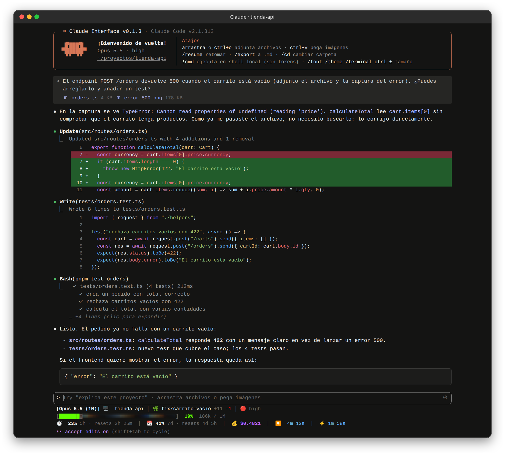
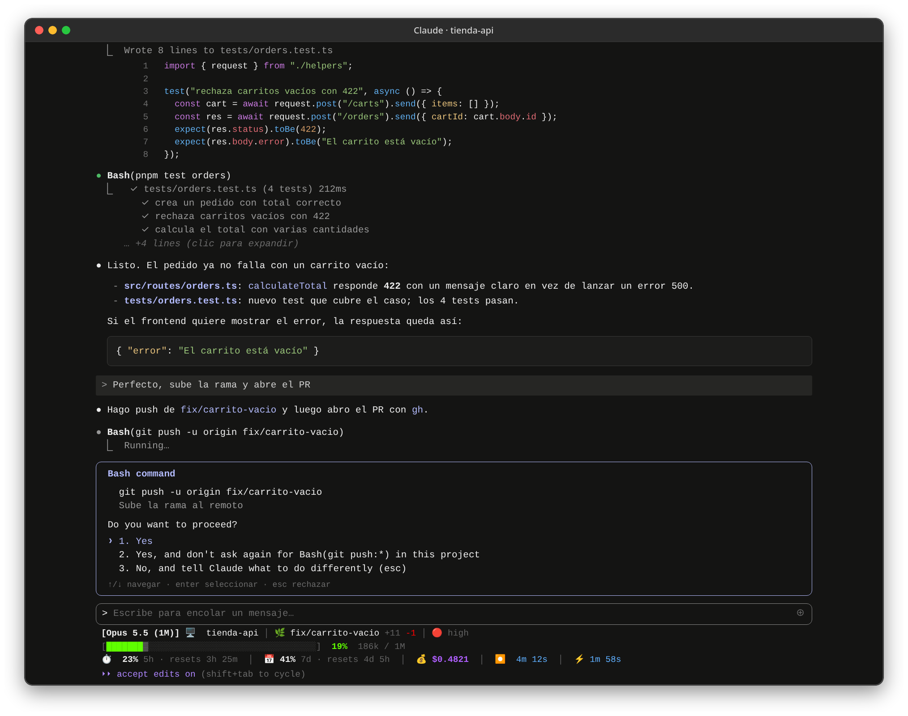
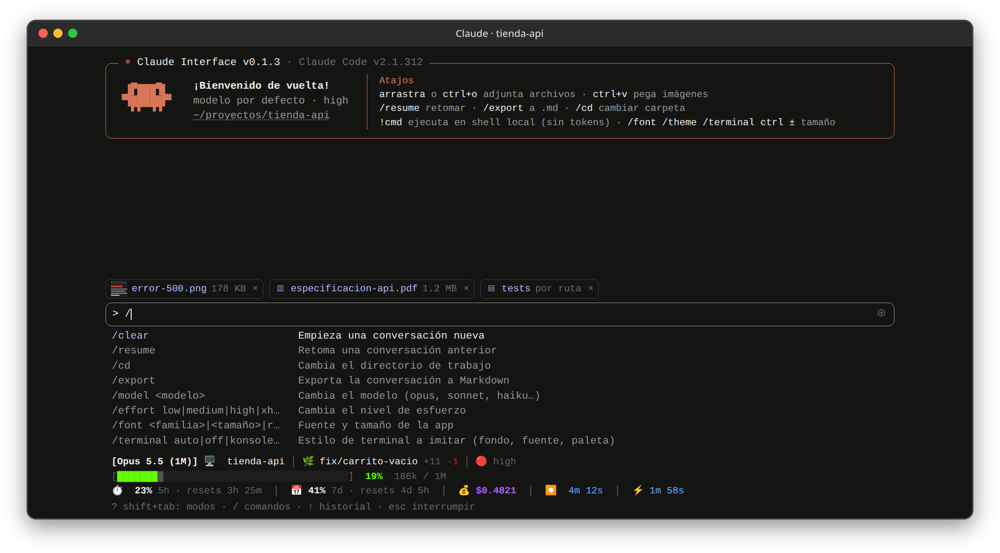

<div align="center">


# Claude Interface

Interfaz de escritorio para [Claude Code](https://docs.claude.com/en/docs/claude-code) con el look de la TUI, pero con la interacción de una app gráfica.

[](https://github.com/GiomarMC/claude-interface/releases/latest)
[](https://github.com/GiomarMC/claude-interface/releases)
[](https://github.com/GiomarMC/claude-interface/actions/workflows/release.yml)


<br />



</div>

## Descargar

Enlaces directos a la última versión:

| Sistema | Arquitectura | Descarga | Notas |
|---|---|---|---|
| 🪟 **Windows** 10/11 | x64 | [**Instalador `.exe`**](https://github.com/GiomarMC/claude-interface/releases/latest/download/Claude-Interface-windows-x64-setup.exe) · [`.msi`](https://github.com/GiomarMC/claude-interface/releases/latest/download/Claude-Interface-windows-x64.msi) | Recomendado el `.exe` |
| 🍎 **macOS** Apple Silicon (M1–M4) | arm64 | [**`.dmg`**](https://github.com/GiomarMC/claude-interface/releases/latest/download/Claude-Interface-macos-arm64.dmg) | [Ver nota](#macos) |
| 🍎 **macOS** Intel | x64 | [**`.dmg`**](https://github.com/GiomarMC/claude-interface/releases/latest/download/Claude-Interface-macos-x64.dmg) | [Ver nota](#macos) |
| 🐧 **Fedora / RHEL / openSUSE** | x86_64 | [**`.rpm`**](https://github.com/GiomarMC/claude-interface/releases/latest/download/Claude-Interface-linux-x86_64.rpm) | |
| 🐧 **Ubuntu / Debian / Mint** | x86_64 | [**`.deb`**](https://github.com/GiomarMC/claude-interface/releases/latest/download/Claude-Interface-linux-x86_64.deb) | |
| 🐧 **Cualquier Linux** | x86_64 | [**`.AppImage`**](https://github.com/GiomarMC/claude-interface/releases/latest/download/Claude-Interface-linux-x86_64.AppImage) | Sin instalar: `chmod +x` y ejecutar |

Versiones anteriores y notas de cada versión en [Releases](https://github.com/GiomarMC/claude-interface/releases).

**Requisito:** tener [Claude Code](https://docs.claude.com/en/docs/claude-code/setup) instalado y con la sesión iniciada (`claude` en el PATH o en `~/.local/bin`). La app usa tu propia instalación y tu cuenta.

### Instalación desde la terminal (Linux)

```sh
# Fedora / RHEL
sudo dnf install https://github.com/GiomarMC/claude-interface/releases/latest/download/Claude-Interface-linux-x86_64.rpm

# Ubuntu / Debian
curl -fLo /tmp/claude-interface.deb https://github.com/GiomarMC/claude-interface/releases/latest/download/Claude-Interface-linux-x86_64.deb
sudo apt install /tmp/claude-interface.deb
```

### macOS

La app no está firmada con un certificado de Apple, así que la primera vez macOS dirá que "está dañada". Después de copiarla a Aplicaciones ejecuta una vez:

```sh
xattr -cr "/Applications/Claude Interface.app"
```

### Actualizaciones

Al abrir (y cada 6 horas) la app busca una versión nueva y muestra un aviso para instalarla y reiniciar; la conversación abierta se retoma al volver. `/update` busca a mano y `/update off` desactiva la búsqueda automática.

- **Windows, macOS y AppImage:** se descarga y se instala sola.
- **.rpm / .deb:** descarga el paquete nuevo y lo instala con `pkexec` (pide tu contraseña en una ventana del sistema).

Las actualizaciones van firmadas y la app verifica la firma antes de instalarlas.

## Casos de uso

### Arreglar un bug pasándole el archivo y la captura del error

Arrastras `orders.ts` y la captura del error a la ventana. El contenido del archivo va directo en el mensaje, así que Claude no gasta llamadas en buscarlo ni leerlo: identifica el fallo en la imagen, edita el código (con el diff en verde y rojo, como en la TUI), escribe el test y lo ejecuta. Todo con tu statusline y el modo *accept edits* activos (captura de arriba).

### Aprobar acciones con el mismo diálogo de permisos

Cuando Claude quiere ejecutar algo que requiere permiso, como un `git push`, aparece el diálogo de la TUI: aceptas una vez, aceptas para siempre en este proyecto o le dices qué hacer distinto. Se maneja con el teclado (`1`/`2`/`3`, `↑`/`↓`, `Esc`) o con el ratón.

<p align="center"></p>

### Adjuntar de todo y usar tus comandos

Imágenes (con miniatura), PDF y carpetas se adjuntan arrastrándolos, con `Ctrl+O` o pegándolos; cada uno se envía de la forma que menos tokens gasta. Al escribir `/` aparecen tus comandos y skills de Claude Code junto con los de la app.

<p align="center"></p>

## ¿Qué es?

No reemplaza a Claude Code: lanza tu `claude` instalado en modo `stream-json`, así que usa tu cuenta, tu `settings.json`, tus skills, MCP, `CLAUDE.md` y tus sesiones. Se puede abrir en un directorio concreto: `claude-interface ~/mi-proyecto`.

## Se adapta a cada usuario

- **Statusline:** ejecuta el `statusLine.command` de tus settings igual que Claude Code (mismo JSON por stdin) y pinta su salida ANSI. Sin statusline configurado, muestra uno sencillo.
- **Settings:** combina `~/.claude/settings.json`, `.claude/settings.json` y `.claude/settings.local.json` del proyecto, con la misma precedencia que Claude Code.
- **Tema:** usa el `/theme` de Claude Code (`dark`, `light`, `*-daltonized`, `*-ansi`). Se puede forzar otro con `/theme`.
- **Terminal:** Claude Code toma el fondo, la fuente y la paleta de la terminal donde corre; la app lee esos mismos datos de tu emulador (Konsole, GNOME Terminal, kitty, Alacritty, Ghostty, foot o Windows Terminal) y se ve igual. `/terminal` muestra cuál detectó y permite elegir otra o desactivarlo.
- **Fuente:** la de tu terminal por defecto; `/font <familia>`, `/font <tamaño>` o `Ctrl +`/`Ctrl -`/`Ctrl 0` la cambian.

## Funciones

- **Adjuntar archivos** arrastrándolos, con `Ctrl+O` o pegándolos desde el gestor de archivos. El contenido de los archivos de texto va directo en el mensaje (sin gastar llamadas de búsqueda/lectura); imágenes y PDF se envían directamente; archivos grandes y carpetas se pasan por ruta.
- **Pegar imágenes** del portapapeles con `Ctrl+V`.
- **Copiar** cada respuesta como Markdown y cada bloque de código con un clic.
- **Exportar** la conversación a `.md` (`/export` o `Ctrl+Shift+E`).
- **Permisos** con el mismo diálogo de la TUI (1/2/3, ↑/↓, Esc), `AskUserQuestion` y aprobación de planes.
- **Modos** con `Shift+Tab`: normal, accept edits, plan, auto, bypass.
- **Comandos `/`** con autocompletado de tus comandos y skills, más `/resume`, `/clear`, `/cd`, `/model`, `/effort`, `/copy`, `/font`, `/theme`, `/terminal`.
- **`!comando`** ejecuta en tu shell local sin gastar tokens; la salida se adjunta como contexto al siguiente mensaje.

## Desarrollo

Requiere Node 22+, pnpm y Rust ([prerequisitos de Tauri](https://tauri.app/start/prerequisites/)).

```sh
pnpm install
pnpm tauri dev     # app en modo desarrollo
pnpm tauri build   # instaladores para el sistema actual
```

Para publicar una versión, sube la versión en `package.json`, `src-tauri/Cargo.toml` y `src-tauri/tauri.conf.json`, y un tag `v*`. GitHub Actions genera los instaladores de Linux, Windows y macOS, publica el release (que las apps instaladas detectan como actualización) y sube copias con nombre fijo para los enlaces de descarga de este README:

```sh
git tag v0.1.4 && git push origin v0.1.4
```

Las capturas del README se generan con datos de ejemplo desde la ruta de demo, que solo existe en desarrollo y simula Claude Code con los mocks de Tauri (`http://localhost:1420/demo?scene=conversation`, `permission` o `start`). Con `pnpm dev` abierto, `scripts/screenshots.sh` las captura con Chrome headless y les añade el marco de ventana (requiere ImageMagick).

El workflow necesita los secrets `TAURI_SIGNING_PRIVATE_KEY` y `TAURI_SIGNING_PRIVATE_KEY_PASSWORD` con la clave de firma del updater. Para generar instaladores en local con `pnpm tauri build` exporta esas mismas variables (o `TAURI_SIGNING_PRIVATE_KEY` con la ruta a la clave).

## Arquitectura

- `src-tauri/src/claude.rs`: lanza `claude -p --input-format stream-json --output-format stream-json --permission-prompt-tool stdio` y reenvía cada línea a la UI.
- `src-tauri/src/files.rs`: lectura de adjuntos, info de git, settings combinados, statusline, historial de sesiones (`~/.claude/projects`), shell local.
- `src-tauri/src/terminal.rs`: lectura de la configuración de los emuladores de terminal.
- `src/lib/session.svelte.ts`: estado de la sesión e interpretación del protocolo.
- `src/lib/prefs.svelte.ts`: tema, fuente y estilo de terminal.
- `src/lib/updater.svelte.ts` y `src-tauri/src/updates.rs`: actualizaciones (plugin de Tauri y paquetes .rpm/.deb).
- `src/lib/components/`: transcripción, herramientas, permisos, prompt y statusline.

La configuración propia de la app (fuente, tema o terminal forzados) se guarda en `config.json` dentro del directorio de configuración de la app (`~/.config/dev.giomarmc.claudeinterface/` en Linux).
